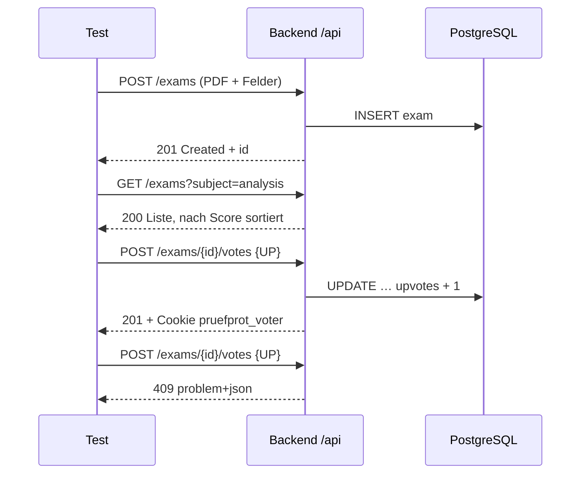

# Integrationstests: Backend/API

Zusammenspiel mehrerer Komponenten mit echter Infrastruktur

::visual::
<TestPyramid :width="330" active="api" />

---
step: 1
topic: 3.2 API
---

# Was ist ein Integrationstest?

<ScopeStack scope="api" />

<div class="grid grid-cols-[1fr_1.1fr] gap-6 mt-4">
<div>

- Prüft das **Zusammenspiel**: HTTP → Controller → Service → Repository → DB
- Mit **echter Infrastruktur** statt Mocks
- Langsamer (Sekunden), daher **weniger** Tests als auf Unit-Ebene

</div>
<div class="card">
<h3><span class="i-carbon-search" /> Was Unit-Tests hier nicht sehen</h3>
<div class="grid grid-cols-2 gap-x-4 gap-y-1 small">
  <div><b>SQL</b>: Teiltreffer, <code>%</code> und <code>_</code></div>
  <div><b>Constraints</b>: Unique → <code>409</code></div>
  <div><b>Mapping</b>: JSON, <code>problem+json</code></div>
  <div><b>Header</b>: <code>Content-Disposition</code></div>
  <div><b>Schema</b>: Flyway-Migrationen</div>
  <div><b>Nebenläufigkeit</b>: atomare Updates</div>
</div>
</div>
</div>

<!--
Integrationstests sitzen in der Mitte der Pyramide. In Prüfprot heißt das: echter HTTP-Request gegen die
Spring-Boot-App, echte Postgres-Datenbank, echte Flyway-Migrationen.
-->

---
step: 2
topic: 3.2 API
---

# Klassisch: Testcontainers statt H2

<FlowSteps small :steps="[
  { title: 'Test startet', text: './gradlew integrationTest', icon: 'i-carbon-play', color: 'blue' },
  { title: 'Container', text: 'Postgres 18 in Docker', icon: 'i-logos-docker-icon', color: 'navy' },
  { title: 'Flyway', text: 'gleiches Schema wie Produktion', icon: 'i-carbon-data-structured', color: 'navy' },
  { title: 'Tests', text: 'echte HTTP-Requests', icon: 'i-carbon-api', color: 'gold' },
  { title: 'Aufräumen', text: 'Container wird verworfen', icon: 'i-carbon-trash-can', color: 'blue' },
]" />

<div class="mt-4 compact">

| | H2 (In-Memory) | Postgres via Testcontainers |
|---|---|---|
| **SQL-Dialekt** | <span class="tag warn">Kompatibilitätsmodus</span> Funktionen, `bytea`, Escaping verhalten sich anders | <span class="tag ok">identisch</span> zur Produktion |
| **Schema** | oft separat oder per Hibernate erzeugt | <span class="tag ok">dieselben</span> Flyway-Migrationen |
| **Sperren, Constraints** | eigene Implementierung | <span class="tag ok">echtes</span> Verhalten unter Last |
| **Laufzeit, Voraussetzung** | <span class="tag ok">sehr schnell</span> keine | <span class="tag warn">Containerstart</span> einige Sekunden, Docker |

</div>

<!--
CLAUDE.md legt fest: Integrationstests gegen echtes Postgres, kein H2.
Grund: Ein grüner Test gegen H2 sagt wenig darüber, ob die Query in Postgres funktioniert.
-->

---
step: 2
topic: 3.2 API
---

# Klassisch: Ein Integrationstest mit Spring Boot

<div class="grid grid-cols-[1.7fr_1fr] gap-4">
<div class="code-xs min-w-0">

```java
@SpringBootTest
@AutoConfigureMockMvc
@Testcontainers
class VoteApiIT {

    @Container @ServiceConnection
    static PostgreSQLContainer db =
            new PostgreSQLContainer("postgres:18.6-alpine");

    @Autowired MockMvcTester mvc;

    @Test
    void secondVoteFromSameBrowserIsRejected() {
        UUID exam = uploadExam();
        Cookie voter = new Cookie("pruefprot_voter", randomUUID().toString());

        assertThat(vote(exam, "UP", voter)).hasStatus(CREATED);
        assertThat(vote(exam, "UP", voter)).hasStatus(CONFLICT)
                .hasContentType(APPLICATION_PROBLEM_JSON);
    }
}
```

</div>

<div class="flex flex-col gap-3 small">
  <div class="card flex gap-3 items-start"><span class="icon-circle light"><span class="i-logos-docker-icon" /></span><div><b><code>@Container</code></b><br>startet Postgres einmal pro Testklasse</div></div>
  <div class="card flex gap-3 items-start"><span class="icon-circle light"><span class="i-carbon-plug" /></span><div><b><code>@ServiceConnection</code></b><br>Spring verbindet sich automatisch, keine URL-Konfiguration</div></div>
  <div class="card flex gap-3 items-start"><span class="icon-circle light"><span class="i-carbon-api" /></span><div><b><code>MockMvcTester</code></b><br>HTTP-Aufrufe mit AssertJ-Assertions</div></div>
</div>
</div>

<!--
Hilfsmethoden uploadExam() und vote() sind weggelassen.
Eigenes Source Set src/integrationTest/java, Task ./gradlew integrationTest.
-->

---
step: 2
topic: 3.2 API
---

# Die API als Testmatrix

<div class="grid grid-cols-[1.45fr_1fr] gap-5">
<div>

| Endpunkt | Fall | Status |
|---|---|:---:|
| `POST /api/exams` | gültiges PDF, alle Felder | <span class="tag ok">201</span> |
| | Feld fehlt, kein PDF, leere Datei, Semester falsch | <span class="tag bad">400</span> |
| | größer als 10 MB | <span class="tag bad">413</span> |
| `GET /api/exams` | Filter, sortiert nach Score | <span class="tag ok">200</span> |
| `GET …/{id}/download` | unbekannte ID | <span class="tag bad">404</span> |
| `POST …/{id}/votes` | erste Stimme | <span class="tag ok">201</span> |
| | zweite Stimme, gleicher Browser | <span class="tag bad">409</span> |
| | `direction` ungültig | <span class="tag bad">400</span> |

</div>
<div>

<p class="small"><b>Fehler einheitlich als <code>application/problem+json</code></b> (RFC 9457):</p>

```json
{
  "type": "about:blank",
  "title": "Conflict",
  "status": 409,
  "detail": "…",
  "instance": "/api/exams/3f2a…/votes"
}
```

<p class="small muted mt-2"><span class="i-carbon-information" /> Die Tabelle steht fast wörtlich in der Spezifikation. Daraus kann die KI systematisch Tests ableiten.</p>

</div>
</div>

<!--
Statuscodes und Fehlerformat sind Teil des Vertrags mit dem Frontend.
Der Text in "detail" ist Implementierungssache; Tests sollten Status, Content-Type und Struktur prüfen.
-->

---
step: 2
topic: 3.2 API
---

# Ablauf: Upload → Suche → Vote

<div class="grid grid-cols-[1.4fr_1fr] gap-5 items-start">
<div>



</div>
<div>

- Ein Test prüft den **ganzen Ablauf** in einem Durchgang
- Jede Antwort hat einen **Vertrag**: Status, Content-Type, Header
- Liste kommt **ohne Dateiinhalt**
- Download (nicht im Bild): `application/pdf` mit sicher kodiertem **`Content-Disposition`**
- Zweite Stimme mit gleichem Cookie → **`409`**

</div>
</div>

<!--
Ein Integrationstest kann diesen ganzen Ablauf in einem Durchgang prüfen.
-->

---
step: 2
topic: 3.2 API
---

# Parallele Votes: nur mit echter DB sichtbar

<div class="grid grid-cols-2 gap-6">
<div>
<h3><span class="i-carbon-close-filled bad" /> Read-Modify-Write in Java</h3>
<RaceTimeline mode="lost" />
</div>
<div>
<h3><span class="i-carbon-checkmark-filled ok" /> Atomar in SQL</h3>
<RaceTimeline mode="atomic" />

```sql
UPDATE exam SET upvotes = upvotes + 1 WHERE id = ?
```

</div>
</div>

<div class="takeaway mt-4"><span class="i-carbon-idea" /> Testidee: <strong>N parallele Votes</strong> mit verschiedenen Voter-IDs → danach muss <code class="!bg-white/15 !text-white">upvotes == N</code> gelten. Mit Mocks oder H2 bleibt das unsichtbar.</div>

<!--
Lost Update: Beide Requests lesen denselben Wert und schreiben ihn erhöht zurück.
Die Spezifikation verlangt daher atomare Updates in SQL. Nebenläufigkeit ist schwer zu testen
(flaky Gefahr), deshalb mit vielen parallelen Requests und echtem Postgres.
-->

---
step: 3
topic: 3.2 API
---

# KI-Demo: Integrationstests schreiben lassen

<div class="grid grid-cols-[1fr_1.25fr] gap-5 h-full">
<div class="flex flex-col gap-3">

<PromptBox>

Schreib Integrationstests für die REST-API: Upload → Liste → Download
und Votes inklusive `409`. Nutze **Testcontainers mit echtem Postgres**,
kein H2. Prüfe Statuscodes und Problem-JSON laut `CLAUDE.md`.

</PromptBox>

<div class="small">

**Worauf achten im Video?**

- Nutzt die KI wirklich Postgres oder weicht sie aus?
- Deckt sie alle Statuscodes der Tabelle ab?
- Wie geht sie mit dem **langsameren Feedback-Loop** um?
- Testet sie Nebenläufigkeit von selbst?

</div>
</div>
<DemoVideo title="Integrationstests mit Testcontainers" duration="ca. 1–2 min" />
</div>

---
step: 3
topic: 3.2 API
---

# KI-Demo: Agent testet die API direkt per curl

<div class="grid grid-cols-[1.35fr_1fr] gap-5">
<div>

```bash
# Leere Datei hochladen
$ curl -s -o /dev/null -w "%{http_code}\n" \
    -F file=@leer.pdf -F university=Jena … localhost/api/exams
400
# Abstimmen mit Cookie-Jar
$ curl -s -c jar -b jar -o /dev/null -w "%{http_code}\n" \
    -H 'Content-Type: application/json' -d '{"direction":"UP"}' \
    localhost/api/exams/$ID/votes
201
$ curl … (gleicher Cookie-Jar)          # → 409
$ curl … (ohne Cookie)                  # → 201
```

</div>
<div class="flex flex-col gap-3">
<DemoVideo title="Agent erkundet die API per curl" duration="ca. 1 min" class="!min-h-[130px]" />
<div class="small">

- **Kein Testcode** nötig, schnelles Erkunden
- Vote-Sperre umgehen ist laut Spezifikation **erlaubt**
- Aber: **nicht wiederholbar** → Befunde in echte Tests überführen

</div>
</div>
</div>

<!--
Mit einem API-Skill (curl-Rezepte, Basis-URL, Cookie-Handling) kann der Agent die API wie ein Tester bedienen.
Was er findet, muss in reproduzierbare Integrationstests überführt werden.
-->

---
step: 3
topic: 3.2 API
---

# Ausblick: Contract Testing Frontend ↔ Backend

<div class="contract">
  <div class="party">
    <span class="i-logos-vue ico" />
    <b>Frontend</b>
    <span class="small muted">Consumer<br><code>api.ts</code></span>
  </div>
  <div class="arrow-col">
    <span class="small">erwartet</span>
    <span class="i-carbon-arrow-right big" />
  </div>
  <div class="party contract-doc">
    <span class="i-carbon-document-tasks ico" />
    <b>Vertrag</b>
    <span class="small">Felder, Typen, Statuscodes<br>z. B. <code>studyProgram</code>, <code>201</code>, <code>409</code></span>
  </div>
  <div class="arrow-col">
    <span class="small">erfüllt</span>
    <span class="i-carbon-arrow-left big" />
  </div>
  <div class="party">
    <span class="i-logos-spring-icon ico" />
    <b>Backend</b>
    <span class="small muted">Provider<br><code>ExamController</code></span>
  </div>
</div>

<div class="grid grid-cols-2 gap-5 mt-5">
<div>

### Klassisch
- **Pact** (Consumer-driven), **Spring Cloud Contract**
- OpenAPI-Schema prüfen
- Bricht, wenn eine Seite den Vertrag ändert

</div>
<div>

### Mit KI
- Vertrag aus `api.ts` **und** Controller ableiten
- Abweichungen finden (Feldnamen, Statuscodes)
- Contract-Tests für beide Seiten generieren

</div>
</div>

<style>
.contract { display: flex; align-items: center; justify-content: center; gap: 14px; margin-top: 8px; }
.party { display: flex; flex-direction: column; align-items: center; text-align: center; gap: 2px; background: var(--uni-gray); border-radius: 10px; padding: 12px 18px; min-width: 170px; line-height: 1.25; }
.contract-doc { background: var(--uni-navy); color: #fff; }
.contract-doc code { background: rgba(255,255,255,.15) !important; color: #fff !important; }
.party .ico { font-size: 34px; }
.arrow-col { display: flex; flex-direction: column; align-items: center; color: var(--uni-gold); }
.arrow-col .big { font-size: 30px; }
</style>

<!--
Optionales Thema. Frontend und Backend sprechen nur über /api miteinander. Ein Contract-Test stellt sicher,
dass beide Seiten dasselbe erwarten, ohne den ganzen Stack starten zu müssen.
-->

---
step: 4
topic: 3.2 API
---

# Bewertung: Integrationstests mit KI

<ProsCons>
<template #pros>

- Schreibt **Testcontainers-Boilerplate** zuverlässig
- Leitet Fälle **systematisch** aus der Statuscode-Tabelle ab
- Erkundet die API **ohne Testcode** (curl, HTTP)
- Findet **Abweichungen** zwischen Spezifikation und API
- Hilfreich beim **Lesen** von Stacktraces und Container-Logs

</template>
<template #cons>

- **Langsamer Feedback-Loop**: jeder Lauf startet Container
- Risiko: weicht auf **H2 oder Mocks** aus, wenn Docker hakt
- **Nebenläufigkeit** korrekt zu testen ist schwer → flaky
- **Testdaten-Isolation** zwischen Tests wird gern vergessen
- curl-Erkundung ist **nicht reproduzierbar**

</template>
<template #note>
<div class="takeaway"><span class="i-carbon-rule" /> Leitplanke in der <code class="!bg-white/15 !text-white">CLAUDE.md</code>: <strong>„Integrationstests gegen echtes Postgres, kein H2.“</strong></div>
</template>
</ProsCons>

---
step: 5
topic: 3.2 API
---

# Skill: `api-testing`

<div class="grid grid-cols-[1.6fr_1fr] gap-5">

```markdown
---
name: api-testing
description: REST-API von Prüfprot testen, per Integrationstest
  (Testcontainers) oder explorativ per curl
---
# API testen
1. Integrationstests: src/integrationTest/java, echtes Postgres
   über @ServiceConnection, niemals H2
2. Pro Endpunkt alle Statuscodes aus der Tabelle der CLAUDE.md
3. Fehler: Status, Content-Type application/problem+json prüfen
4. Votes: Cookie pruefprot_voter mitschicken, 409 beim 2. Mal
5. Zähler: auch parallele Requests testen (N Votes → N)
6. Explorativ: curl -c/-b jar gegen http://localhost/api,
   Befunde danach als Integrationstest festhalten
7. Ausführen: ./gradlew integrationTest (Docker nötig)
```

<SkillCollection current="api-testing" />
</div>
